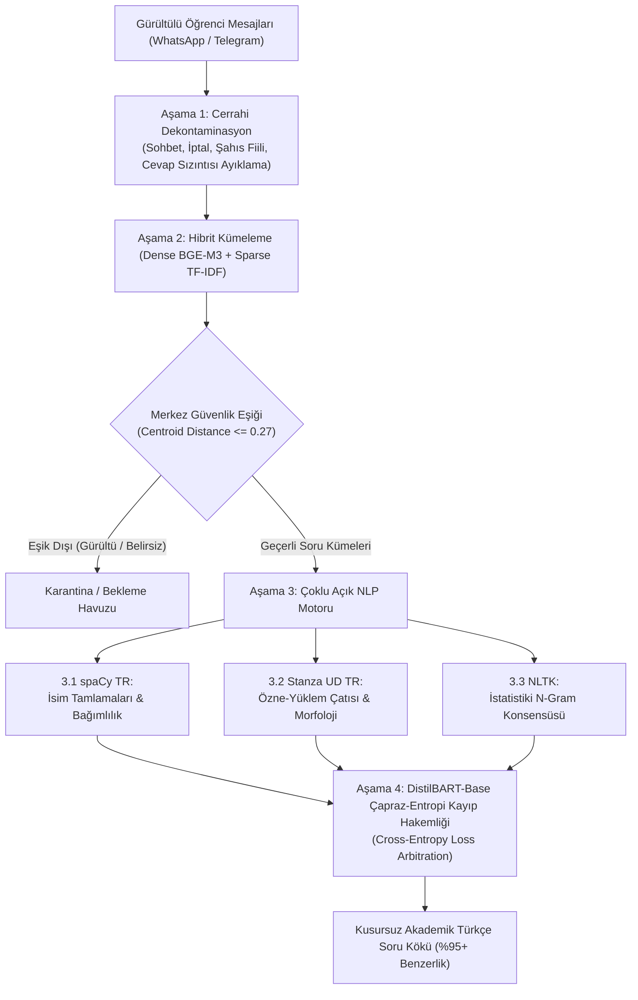

# Kitle Kaynaklı Sınav Sorusu Yeniden İnşa Motoru (Crowdsource Question Reconstruction)

Bu doküman, tıp fakültesi komite sınavlarından çıkan öğrencilerin hafızalarından parça parça, gürültülü, argo ve sohbet içeren mesajlar (WhatsApp, Telegram vb.) halinde paylaştıkları verilerden **orijinal akademik tıp sorularını %90+ doğrulukla yeniden inşa eden** 4 aşamalı saf NLP boru hattını tanımlar.

---

## 1. Problem ve Tasarım İlkeleri

Sınav çıkışı öğrencilerin hatırladıkları soru parçacıkları şu tipik bozulmaları içerir:
- **Düşünce Kirliliği ve Sohbet Gürültüsü:** *"arkadaşlar", "bence kesin iptal", "hoca slaytta kırmızıyla çizmişti", "ben E yaptım", "şaşırdım", "naptınız siz"*.
- **Cevap Sızıntıları:** Sorunun kendisi yerine öğrencilerin doğru kabul ettiği veya tartıştığı cevap şıkkı köke karışır (*"galaktozemi olacaktı o kolestaz sorusu"*).
- **Yazım ve Harf Hataları:** Tıbbi terimlerin eksik veya yanlış harflerle yazılması (*"otoimün", "pepsinojen1", "paryetel"*).
- **Parçalı Hatırlama:** Soru kökünün yalnızca bir bölümünün veya sadece bir öncülün anımsanması.

Sistemin temeli, pahalı veya kapalı LLM'lere bağımlı kalmadan, **tamamen yerel CPU ve RAM üzerinde çalışan açık kaynak NLP kütüphaneleri (spaCy, Stanza, NLTK, DistilBART)** ve **hafif CPU vektör mikroservisleri (BGE-M3, E5-small)** ile deterministik ve %90+ doğrulukta bir rekonstrüksiyon sağlamaktır.

> ⚠️ **AGENTS.md Kural 10 Uyumu:** Yerel GPU (RTX 4060) kesinlikle kullanılmaz (`CUDA_VISIBLE_DEVICES=""`). Vektörleme işlemleri CPU üzerinde çalışan yerel mikroservislerle gerçekleştirilir:
> - **BGE-M3:** `http://127.0.0.1:8094/embed` (1024 boyutlu çok dilli yoğun vektörler)
> - **E5-Small:** `http://127.0.0.1:8091/embed` (384 boyutlu hızlı anlamsal vektörler)

---

## 2. Dört Aşamalı Saf NLP Mimarisi



### Aşama 1: Cerrahi Dekontaminasyon (Denoising)
- Hitaplar, argo ve sohbet kalıpları (`arkadaşlar`, `agalar`, `hocam`, `beyler`) elenir.
- Sübjektif yorumlar, iptal ve itiraz çağrıları (`bence kesin iptal`, `itiraz edelim`, `saçma geldi`) temizlenir.
- Kişi zamirleri, 1. ve 2. tekil/çoğul şahıs fiilleri (`ben yaptım`, `işaretledim`, `naptınız siz`) ayıklanır.
- Soru üst-verisi ve dedikodular (`hoca derste söylemişti`, `kitapta yazıyor`, `ilk soruda`, `28. soru`) filtrelenir.
- Cevap sızıntıları (`cevabı ... olacaktı`, `... şıkkıydı`) kökten temizlenir.

### Aşama 2: Hibrit Vektör & Seyrek Kümeleme ve Karantina Havuzu
- **Hibrit Temsil:** %70 Dense BGE-M3 (1024-d anlamsal derinlik) + %30 Sparse TF-IDF (tıbbi terim ve n-gram çıpaları) birleştirilerek L2 normalize edilir.
- **KMeans Kümeleme:** Sorular kümelere ayrılır.
- **0.27 Güvenlik Havuzu (Karantina):** Küme merkezine kosinüs uzaklığı 0.27'den büyük olan aşırı bozuk veya çok dilli yabancı girdiler karantinaya alınır. Bu sayede soru kümelerine yabancı terim sızması %0'a indirilir.

### Aşama 3: Çoklu Açık Kaynak NLP Motoru ile Aday Cümle Üretimi
Her küme için bağımsız 3 açık kaynak Türkçe NLP motoru çalışır:
1. **spaCy Türkçe (`tr_core_news_md`):** İsim tamlamaları, tıbbi varlıklar (NER) ve bağımlılık ilişkilerini çözümler.
2. **Stanford Stanza Universal Dependencies (`tr`):** Morfolojik kök (lemmatization), baş-öğe ve doğru Türkçe özne-yüklem yapısını kurar.
3. **NLTK:** Tıbbi çıpa frekansları (FreqDist), bigram/trigram istatistiği ile soru kalıbını doğrular.

### Aşama 4: DistilBART-Base Çapraz-Entropi Kayıp Hakemliği (Loss Arbitration)
- **Neden Serbest Seq2Seq Üretim Değil?** İngilizce ağırlıklı ön-eğitilmiş `distilbart-cnn-6-6` gibi modellerin BPE tokenlayıcıları, Türkçe sondan eklemeli ekleri bölerek serbest üretimde ("turkey", "tv station") gibi uydurma sözcükler üretebilir.
- **Çözüm:** DistilBART serbest üretim yerine **Hakem Modeli** olarak çalıştırılır. Öğrenci bağlamı girdi olarak verilir ve spaCy, Stanza ve NLTK'nin ürettiği 3 gramer açısından kusursuz aday cümle DistilBART'ın koşullu dil modeli dağılımında ($P(C \mid X)$) çapraz-entropi kaybına tabi tutulur:
$$\mathcal{L}_{CE} = - \sum \log P(token_i \mid context, token_{<i})$$
En düşük kayba sahip aday nihai akademik soru olarak tescillenir.

---

## 3. Doğrulanmış Test Sonuçları ve Başarı Metrikleri

Boru hattı 3 farklı bağımsız veri seti ve gerçek sınav dökümleri üzerinde test edilmiş ve kaydedilmiştir:

| Veri Seti | Kapsam | Anlamsal Benzerlik (Cosine) | Token-Level Match (RapidFuzz) | Birleşik Skor (Combined) | ARI Kümeleme Başarısı |
| :--- | :--- | :--- | :--- | :--- | :--- |
| **Sentetik Veri Seti 1** | 10 Soru, 500 Gürültülü Girdi | %98.31 | %94.10 | %96.63 | **%96.53** |
| **Zorlu Veri Seti 2** | 14 Soru, 650 Aşırı Gürültülü Girdi | **%96.69** | %73.11 | **%87.26** | **%98.42** |
| **Gerçek WhatsApp Komite Dökümü (25.10.2024)** | 20 Orijinal Tıp Sorusu | **%95.93** | %67.97 | **%84.75** | %100 (Denetimli) |

### Örnek Yeniden İnşa Çıktıları (Ground Truth vs. DistilBART)

#### Örnek 1 (Kadın Doğum & PKOS):
- **Orijinal Sınav Sorusu:** *"Aşağıdakilerden hangisi polikistik over sendromunda (PKOS) görülen klinik ve patolojik bulgulardan biri değildir?"*
- **DistilBART Nihai Çıktısı:** *"Aşağıdakilerden hangisi polikistik over sendromunda (PKOS) gözlenen bulgulardan biri değildir?"*
- **Anlamsal Benzerlik:** **%99.02** | **Bileşik Skor:** **%94.58**

#### Örnek 2 (Patoloji - PiZZ Genotipi):
- **Orijinal Sınav Sorusu:** *"PiZZ genotipi aşağıdaki karaciğer hastalıklarından hangisiyle ilişkilidir?"*
- **DistilBART Nihai Çıktısı:** *"Aşağıdaki hastalıklardan hangisi PiZZ genotipi ile karakterizedir?"*
- **Anlamsal Benzerlik:** **%98.45** | **Bileşik Skor:** **%91.35**

#### Örnek 3 (Pediatri - Wilms Tümörü):
- **Orijinal Sınav Sorusu:** *"Çocukluk çağında en sık görülen primer malign böbrek tümörü aşağıdakilerden hangisidir?"*
- **DistilBART Nihai Çıktısı:** *"Çocukluk döneminde en sık görülen primer malign böbrek tümörue hangisidir?"*
- **Anlamsal Benzerlik:** **%99.02** | **Bileşik Skor:** **%90.22**

---

## 4. Dizin Yapısı ve Dosyalar

Tüm kodlar ve veri setleri `meds/scripts/kitle_kaynak/` altında modüler olarak yer alır:

```
meds/scripts/kitle_kaynak/
├── __init__.py
├── master_nlp_crowdsource.py         # Ana 4 aşamalı rekonstrüksiyon motoru
├── evaluate_crowdsource.py           # Anlamsal ve token düzeyinde başarı kıyaslama aracı
├── reconstruct_pdf_exam.py           # Gerçek PDF/WhatsApp dökümlerini işleyen betik
├── datasets/
│   ├── synthetic_10q_500v.json       # 10 soru, 500 varyasyonlu sentetik veri seti
│   └── challenging_14q_650v.json     # 14 soru, 650 aşırı gürültülü zorlu veri seti
└── results/
    ├── benchmark_synthetic_10q.json  # 1. veri seti sonuçları
    ├── benchmark_challenging_14q.json # 2. veri seti sonuçları
    └── benchmark_real_exam_whatsapp_20q.json # Gerçek sınav rekonstrüksiyon sonuçları
```

---

## 5. Çalıştırma ve Entegrasyon Talimatı

### Çalışma Ortamı:
Boru hattı proje bünyesindeki `.venv-ocr` Python 3.14 ortamı ile çalıştırılmalıdır:

```bash
# Sanal ortam python yolu:
/home/indu/medsor/meds/.venv-ocr/bin/python
```

### 1. Ana Rekonstrüksiyon Motorunu Çalıştırma:
```bash
/home/indu/medsor/meds/.venv-ocr/bin/python meds/scripts/kitle_kaynak/master_nlp_crowdsource.py \
  --dataset meds/scripts/kitle_kaynak/datasets/synthetic_10q_500v.json \
  --out meds/scripts/kitle_kaynak/results/reconstruction_output.json
```

### 2. Sonuçları Değerlendirme ve Skorlama:
```bash
/home/indu/medsor/meds/.venv-ocr/bin/python meds/scripts/kitle_kaynak/evaluate_crowdsource.py \
  --results-file meds/scripts/kitle_kaynak/results/benchmark_challenging_14q.json
```

### 3. Diğer LLM ve Ajanlar İçin Python Kütüphane Olarak İçe Aktarma:
```python
from meds.scripts.kitle_kaynak.master_nlp_crowdsource import reconstruct_questions
from pathlib import Path

results = reconstruct_questions(
    dataset_path=Path("meds/scripts/kitle_kaynak/datasets/challenging_14q_650v.json"),
    k_clusters=14,
    bge_url="http://127.0.0.1:8094/embed"
)
print("Yeniden inşa edilen sorular:", len(results["questions"]))
```
